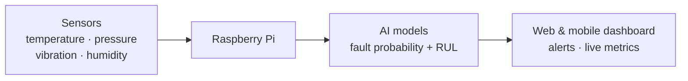

# PreTex — Predictive Maintenance for Textile Machines

> Predicts machine failures **before they happen** from four IoT sensor signals (temperature, pressure, vibration, humidity), so maintenance can be planned instead of reacting to breakdowns.

🥈 **2nd place, ENISo IoT Challenge** (national hackathon, March 2025)

---

## The problem

Unplanned machine breakdowns stop production lines, cost money and delay deliveries. In industries like textiles, a single failing machine can block a whole line. Maintenance is usually either **reactive** (fix it after it breaks) or **scheduled** (replace parts whether they need it or not). Both waste time and money.

## Our solution

A custom-built device on each machine measures **temperature, pressure, vibration and humidity** in real time. Two AI models turn those readings into decisions: one **classifies whether a failure is likely**, the other **estimates the Remaining Useful Life (RUL)**. Alerts, live metrics and predictions are shown on a web and mobile dashboard.



**Why these 4 signals for textile machines:** overheating can burn fibres and damage components; incorrect pressure wastes dye and material and wears the machine; vibration reveals misalignment, imbalance or bearing wear in fast-moving parts; and humidity matters because fibres such as cotton become brittle or swell, causing tension problems.

This repository contains the **AI part** of the system: model training and predictions.

## The model

| Step | Choice | Why |
|---|---|---|
| Data | 7,672 sensor readings from pumps, compressors and turbines, labelled healthy / faulty (public Kaggle dataset) | No textile-machine data was available during the hackathon, so a general industrial dataset with the same 4 signals was used |
| Features | Temperature, pressure, vibration, humidity + one-hot equipment type | Location dropped: not a physical signal |
| Imbalance | Only ~10 % of readings are faulty → **SMOTE** on the training set only | Without it the model learns to always say "healthy" |
| Model | **XGBoost** classifier | Strong on tabular sensor data, fast to train |
| Decision | Faulty if probability **> 0.7** | Fewer false alarms for technicians |

### Remaining Useful Life (prototype)
We wanted the system to also say **how long a machine has left**, but no public dataset with this kind of failure history was available. For the hackathon, we **generated** RUL values with a degradation formula (a base lifetime per equipment type minus penalties for heat, vibration, pressure and humidity) and trained an XGBoost regressor on them (`src/rul_estimation.py`).

This demonstrates the pipeline end to end, but it is **not a validated RUL prediction**: the model learns a formula we wrote. The plan is to retrain it on real data collected by our device on textile machines.

## Run it

```bash
pip install -r requirements.txt
cd src

# Train the fault classifier (prints the confusion matrix and classification report)
python train_fault_classifier.py

# Predict the state of one machine
python predict.py --temperature 50 --pressure 34 --vibration 1.5 --humidity 20 --equipment Compressor

# Experimental RUL pipeline
python rul_estimation.py
```

## Repository structure

```
├── data/equipment_anomaly_data.csv     # Sensor dataset
├── models/machine_failure_predictor.pkl  # Trained model + scaler
└── src/
    ├── train_fault_classifier.py   # SMOTE + XGBoost, threshold 0.7
    ├── predict.py                  # Prediction for one machine
    └── rul_estimation.py           # Experimental RUL estimation
```

## Tech stack

Python · XGBoost · scikit-learn · imbalanced-learn (SMOTE) · pandas · joblib

## Team & my contribution

Built during the ENISo IoT Challenge by **Mohamed Aziz Turki, Mouhaned Ben Abdelhafidh, El Aziza Mariem Lanouar and Helmi Soudana**.

**My part:** all the AI: data preparation, handling the class imbalance, training and evaluating the fault classifier, the RUL prototype, and the prediction script.

My teammates built the hardware (sensors on a Raspberry Pi) and the web and mobile dashboard; their code is not included in this repository.

*Dataset: public industrial equipment sensor dataset from Kaggle.*
